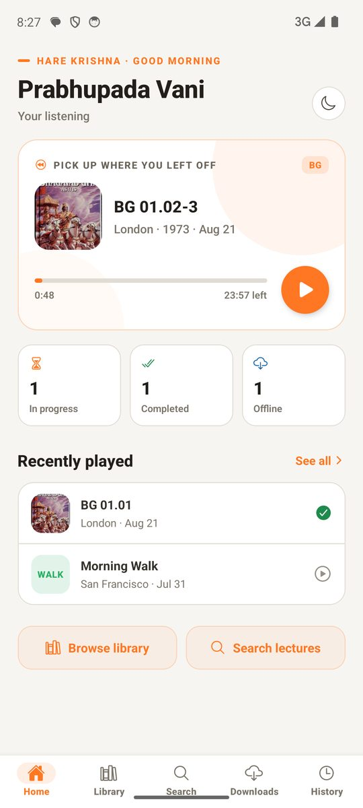
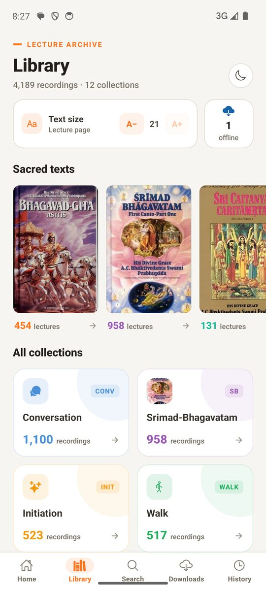
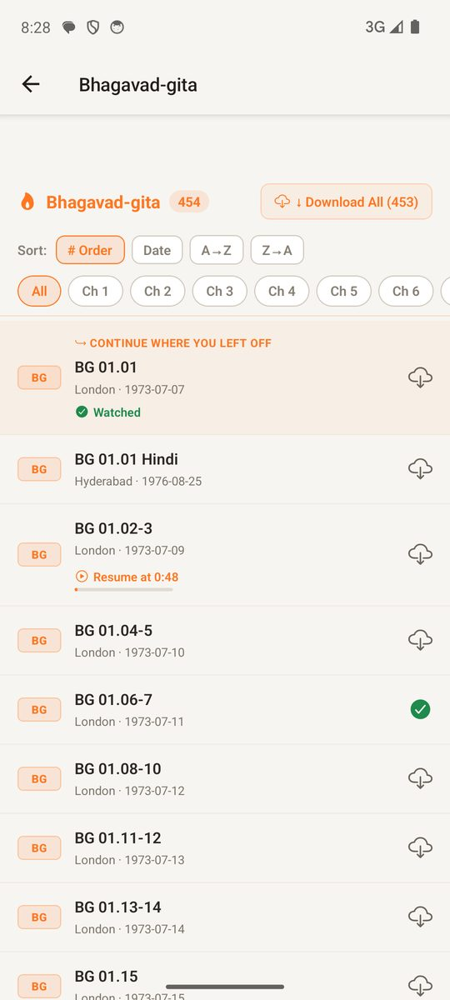
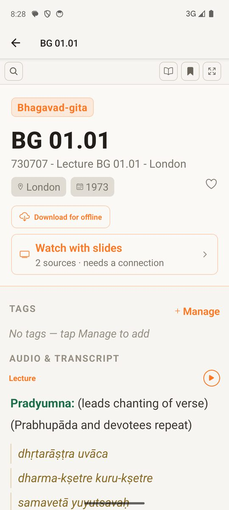

# Prabhupada Vani

<p><a href="https://github.com/shivam1234-hub/prabhupad-vani-app/releases/latest/download/PrabhupadaVani.apk"><b>⬇️ Download APK</b></a> · <a href="https://github.com/shivam1234-hub/prabhupad-vani-app/releases/latest">all versions</a><br><sub>Android: open the downloaded file and tap Install. You may need to allow installs from your browser first.</sub></p>

## Screenshots

<table><tr><td align="center"><br><sub>Home</sub></td><td align="center"><br><sub>Library</sub></td><td align="center"><br><sub>Bhagavad-gita lectures</sub></td><td align="center"><br><sub>Lecture with transcript</sub></td></tr></table>


An Android app (with a Windows desktop version) for listening to **Srila Prabhupada's lectures** with the full transcript alongside the audio.

## Features

### Lectures
- **1,412 lectures:** 454 on Bhagavad-gita and 958 on Srimad-Bhagavatam, plus conversations and morning walks. Audio and transcripts come from vanisource.org.
- **Library:** browse by category, with Bhagavad-gita, Srimad-Bhagavatam and Caitanya-caritamrta covers. Filter by type, year and place.
- **Search** across every lecture.
- **Find by length:** type how many minutes you have and get the lectures closest to that length, grouped by Bhagavad-gita, Srimad-Bhagavatam, Caitanya-caritamrta and the rest.
- **Downloads** for offline listening.
- **History**, with the resume position for every lecture.

### Listening
- Full audio player: seek, skip 15 seconds back or forward, playback speed, and lectures in several parts.
- **Mini player** that stays visible on every screen while audio plays.
- **Background playback** with lock-screen and notification controls (BG, SB and CC cover art), and play/pause from Bluetooth or wired earphones.
- **Autoplay** of the next lecture, with the open transcript following along.

### Reading along
- **Transcript** shown with the audio, with search-with-arrows to jump between matches.
- **Auto-scroll:** the transcript scrolls at a steady speed while the lecture plays, with 10 speeds; the control hides itself and comes back with a tap.
- **Focus mode:** transcript only, no distractions.
- **Word meanings:** long-press any word (double-click on Windows) for an offline meaning. English words use WordNet; Sanskrit words use only Srila Prabhupada's own translations.
- **Presentation mode:** the lecture shown as slides, in time with the audio, for the lectures that have been aligned.
- **Watch with slides:** about 680 lectures link to YouTube videos with the words shown on screen.

### Home and comfort
- **Home:** what's playing now, "pick up where you left off", today's unfinished lectures and recently played.
- Watched and resume badges on every list. Opening a category jumps to the lecture you last played.
- **Text size** control that applies to the whole app.
- **Light and dark** themes, following the phone's setting by default.

## Built with
Expo SDK 54, React Native 0.81, Expo Router, react-native-track-player. `desktop/` is the Windows build: Electron around the Expo web export.

## Building
```bash
npm install
npx expo prebuild -p android
cd android && ./gradlew assembleRelease
```
Use JDK 21 (Android Studio's bundled JBR). Optional settings go in `.env` (see `.env.example`).
